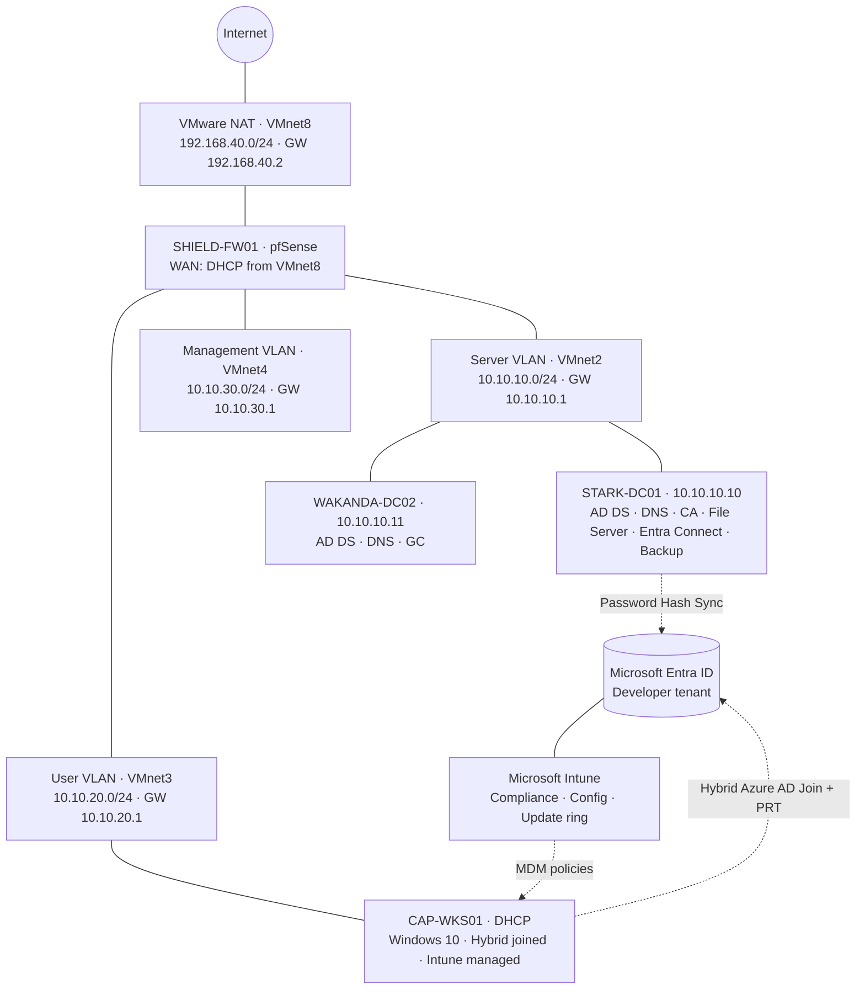

# 🛡️ Avengers Enterprise Grid — Hybrid Identity & Infrastructure Lab

**Author:** Raj Modi

**Platform:** VMware Workstation · Windows Server 2019 · Windows 10 · pfSense · Microsoft Entra ID · Microsoft Intune

**Last updated:** November 12, 2026

**Status:** ✅ Phase 1 (Infrastructure) complete · 🔄 Phase 2 (Security) in progress — Components 1 and 2A done

An enterprise-grade hybrid IT environment built from scratch to mirror how real organizations design, secure, and operate on-premises Active Directory integrated with Microsoft Entra ID and Microsoft Intune. Every component follows enterprise conventions (static infrastructure IPs, segmented networks, RBAC, layered Group Policy, dual domain controllers, pilot rings, tested backups), and every real problem hit along the way is documented with its root cause and fix.

This README follows the **order the lab was actually built**. Troubleshooting entries are numbered in the order they happened (`#1`–`#37`), and the same numbers appear in the workflow chart.

---

## 📑 Contents

1. [Project status](#-project-status)
2. [Architecture](#️-architecture-current-state)
3. [Workflow chart](#-workflow-chart)
4. [Environment inventory](#️-environment-inventory)
5. [Step 0 — Planning and design decisions](#step-0--planning-and-design-decisions)
6. [Part A — Hybrid identity foundation](#part-a--hybrid-identity-foundation-march-2026)
7. [Part B — Phase 1 components 1–6](#part-b--phase-1-components-16-march-2026)
8. [Part C — Tenant migration](#part-c--tenant-migration-april-2026)
9. [Part D — Recovery after extended downtime](#part-d--recovery-after-extended-downtime-october-2026)
10. [Component 7 — Microsoft Intune](#component-7--microsoft-intune-octobernovember-2026)
11. [Component 8 — Backup and recovery](#component-8--backup-and-recovery-november-2026)
12. [Phase 2 · Component 1 — Conditional Access + MFA](#phase-2--component-1--conditional-access--mfa-november-2026)
13. [Phase 2 · Component 2A — Defender Antivirus + ASR (Intune)](#phase-2--component-2a--defender-antivirus--attack-surface-reduction-november-2026)
14. [Troubleshooting log](#-troubleshooting-log-chronological)
15. [Known deviations](#️-known-deviations-and-limitations)
16. [Operations runbook](#-operations-runbook)
17. [Roadmap](#-roadmap--phase-2-security-layer)

---

## 📊 Project Status

| Order | Stage | Status |
|---|---|---|
| 0 | Planning and design decisions | ✅ |
| A | Hybrid identity foundation (AD, DNS, DHCP, client, Entra Connect, Hybrid Join) | ✅ |
| B1 | Component 1 — NTP time hierarchy | ✅ |
| B2 | Component 2 — Baseline Group Policy | ✅ (documented deviations) |
| B3 | Component 3 — Certificate Authority (PKI) | ✅ |
| B4 | Component 4 — File Server + NTFS RBAC | ✅ |
| B5 | Component 5 — pfSense firewall + VLAN segmentation | ✅ |
| B6 | Component 6 — Secondary DC + FSMO distribution | ✅ |
| C | Tenant migration (original tenant → new tenant) | ✅ |
| D | Entra Connect recovery after ~6 months offline | ✅ |
| 7 | Component 7 — Microsoft Intune (replaces WSUS) | ✅ |
| 8 | Component 8 — Backup and recovery (restore-tested) | ✅ |
| P2-1 | Phase 2 · Component 1 — Conditional Access + MFA | ✅ |
| P2-2A | Phase 2 · Component 2A — Defender Antivirus + ASR rules (Intune) | ✅ |
| P2-2B | Phase 2 · Component 2B — Wazuh endpoint detection | ⏳ Next |
| P2-3 → P2-8 | Phase 2 · Components 3–8 (see [Roadmap](#-roadmap--phase-2-security-layer)) | ⏳ |

---

## 🏗️ Architecture (current state)



---

## 🖧 Workflow Chart

The full build in order, with every problem hit (amber, numbered to match the troubleshooting log) and its fix (green). Dashed arrows show where the build resumed after a fix.

<details>
<summary>Show the workflow chart</summary>


</details>

---

## 🖥️ Environment Inventory

| VM | Role | Network | IP | RAM | Disks |
|---|---|---|---|---|---|
| STARK-DC01 | Primary DC (Schema, Domain Naming, PDC), DNS, AD CS (AVENGERS-CA), File Server, Entra Connect, Windows Server Backup | VMnet2 | 10.10.10.10 (static) | 4 GB | 60 GB OS + 60 GB backup |
| WAKANDA-DC02 | Secondary DC (RID, Infrastructure), DNS, Global Catalog | VMnet2 | 10.10.10.11 (static) | 3 GB | 60 GB |
| SHIELD-FW01 | pfSense firewall, router, NAT, DHCP for client VLANs | VMnet8/2/3/4 | 10.10.10.1 / 10.10.20.1 / 10.10.30.1 | 2 GB | 20 GB |
| CAP-WKS01 | Windows 10 Pro, domain + hybrid joined, Intune managed | VMnet3 | DHCP (10.10.20.100–200) | 3–4 GB | 60 GB |

| Identity | Value |
|---|---|
| AD forest / domain | `avengers.local` (NetBIOS `AVENGERS`), forest/domain level 2016 |
| Entra tenant | `<tenant>.onmicrosoft.com` (Microsoft 365 Developer tenant, E5) |
| Cloud UPN suffix | `@<tenant>.onmicrosoft.com` |

**Host:** 12-core Intel i7 · 16 GB RAM · 1 TB NVMe SSD. RAM is the constraint, so VMs run in batches. WAKANDA-DC02 must be powered on for any FSMO or forest-wide operation (see #29).

### Active Directory structure

```
avengers.local
 ├── Avengers-Users        tony.stark · steve.rogers · bruce.banner · peter.parker (restore-test user)
 ├── Avengers-Computers    CAP-WKS01
 ├── Avengers-Groups       HR-Group · IT-Group · Exec-Group · FileServer-Users
 ├── Servers
 └── Service-Accounts
```

---

# Step 0 — Planning and Design Decisions

Decisions made before building, and why:

| Decision | Choice | Reason |
|---|---|---|
| Nested virtualization | **Not used** (#1) | Only needed for Hyper-V inside a VM; avoided changing the host |
| Server addressing | **Static IPs** | DHCP reservations were tested and rejected for DCs (#2); a DHCP outage must never take identity offline |
| Client addressing | DHCP | Enterprise standard for endpoints |
| Naming | Marvel theme, enterprise conventions | `avengers.local`, `STARK-DC01`, `CAP-WKS01`, `SHIELD-*` |
| AD layout | Dedicated OUs, not default containers | Targeted GPOs and delegation |
| Access control | Security groups only (RBAC) | Never assign permissions to individual users |
| Password policy | Only in Default Domain Policy | Everything else in named GPOs |
| Cloud identity | `.local` internally + routable UPN suffix | `.local` cannot be used in Entra ID |
| Authentication | Password Hash Sync + Hybrid Azure AD Join | Most common enterprise hybrid model |
| DNS | Clients use DCs only; only DCs forward externally | AD depends on internal DNS |

---

# Part A — Hybrid Identity Foundation (March 2026)

> Built on a flat network (VMnet8, `192.168.40.0/24`). It was segmented into VLANs later in Component 5.

### A1. VMware network
**Edit → Virtual Network Editor → VMnet8 (NAT)**: subnet `192.168.40.0/24`, gateway `192.168.40.2`.

### A2. Domain controller STARK-DC01
1. Create the VM from the Windows Server 2019 ISO (Desktop Experience); rename to `STARK-DC01`.
2. Static IPv4: `192.168.40.10/24`, gateway `192.168.40.2`, DNS `192.168.40.10`.
   - First attempt used an address outside the VMnet8 subnet, causing "Destination host unreachable" (#3).
3. **Server Manager → Add Roles and Features →** Active Directory Domain Services + DNS.
4. **Promote → Add a new forest →** `avengers.local` (NetBIOS `AVENGERS`); set the DSRM password; reboot.
5. Verify the `avengers.local` and `_msdcs` zones in `dnsmgmt.msc`.

### A3. DHCP
1. Install the DHCP role and **authorize** it in AD.
2. Scope `SHIELD-SCOPE` with options 003 Router, 006 DNS (DC), 015 `avengers.local`; activate.

### A4. OUs, users and workstation
1. Create the OUs shown above and users `tony.stark`, `steve.rogers`, `bruce.banner`.
2. Install CAP-WKS01 (Windows 10 **Pro**), confirm DNS points to the DC, join `avengers.local`, move it to **Avengers-Computers**, sign in as `AVENGERS\steve.rogers`.

### A5. Microsoft Entra Connect
1. Download from **entra.microsoft.com → Identity → Hybrid management → Microsoft Entra Connect** (the Download Center page was retired, #4).
2. Install with **Password Hash Synchronization**.
3. Users synced with the tenant's default `onmicrosoft.com` UPN. A custom domain can't be verified on a developer tenant, so the tenant suffix is used (#5).

### A6. Hybrid Azure AD Join
1. Entra Connect → **Configure → Configure device options → Configure Hybrid Azure AD join** → Windows 10 or later → `avengers.local`.
2. Verify the SCP: `adsiedit.msc` → **Connect to → Configuration** naming context → `CN=Services` → `CN=Device Registration Configuration` (#6).
3. On CAP-WKS01: `dsregcmd /leave`, reboot, sign in as `AVENGERS\steve.rogers`, `dsregcmd /join`.
4. Client lost internet during this step; fixed with a DNS forwarder on the DC (#7).

### A7. UPN alignment and PRT
1. `domain.msc` → **Active Directory Domains and Trusts → Properties** → add the tenant's `onmicrosoft.com` domain as a UPN suffix (#8).
2. Change each user's UPN to that suffix, then `Start-ADSyncSyncCycle -PolicyType Delta`.
3. Sign out, sign back in as `AVENGERS\steve.rogers`, run `dsregcmd /refreshprt`.

**Validation** (on CAP-WKS01, in a **non-elevated** Command Prompt as the signed-in user):
```
dsregcmd /status
```
`DomainJoined : YES` · `AzureAdJoined : YES` · `AzureAdPrt : YES` · `EnterpriseJoined : NO` (expected for hybrid join)

---

# Part B — Phase 1 Components 1–6 (March 2026)

## ⏱️ Component 1 — NTP Time Hierarchy

**Why:** Kerberos rejects tickets when clocks differ by more than 5 minutes, and SIEM correlation depends on consistent timestamps.

**Design:** Internet NTP → PDC Emulator (STARK-DC01) → other DCs → domain members.

```cmd
netdom query fsmo
w32tm /config /manualpeerlist:"pool.ntp.org,0x8 time.windows.com,0x8" /syncfromflags:manual /reliable:YES /update
net stop w32time & net start w32time
w32tm /resync /force
w32tm /query /status
```

**Validation:** DC source `pool.ntp.org`; CAP-WKS01 source is a domain controller; `w32tm /stripchart /computer:STARK-DC01 /samples:5` offset under 1 second.

---

## 🛡️ Component 2 — Baseline Group Policy

| GPO | Linked to | Contents |
|---|---|---|
| Default Domain Policy | Domain | Password history 24, max age 90, min age 1, complexity; lockout 5 attempts / 15 min |
| SHIELD-Workstation-Baseline | Avengers-Computers | Guest disabled, Administrator renamed `SHIELD-Admin`, legal logon banner |
| SHIELD-User-Baseline | Avengers-Users | Drive map `S:` → `\\STARK-DC01\SHIELD-Share` |
| SHIELD-Audit-Policy | Domain | Advanced audit (logon, account mgmt, lockout, file system, policy change, privilege use, system) |

**Validation:** `gpresult /v` as steve.rogers shows SHIELD-User-Baseline; `gpresult /r /scope computer` shows the computer GPOs (#9); Event IDs 4624/4625/4648 present.

**Deviations:** minimum password length **7** (standard 12+); screen lock, AutoPlay, CMD and Control Panel restrictions, and wallpaper deferred.

---

## 🔐 Component 3 — Certificate Authority (PKI)

| Setting | Value |
|---|---|
| Type | Enterprise Root CA (single-tier) |
| Name | `AVENGERS-CA` on STARK-DC01 |
| Key / Hash | RSA 4096 / SHA256 |
| Validity | 10 years |
| Role services | Certification Authority + Web Enrollment |
| Templates | Computer, User, Web Server, Domain Controller |

GPO `SHIELD-AutoEnrollment` (linked at domain) enables certificate auto-enrollment; trigger with `gpupdate /force` and `certutil -pulse`.

**Validation:** `certsrv.msc` and `pkiview.msc` healthy; CAP-WKS01 holds a computer certificate from AVENGERS-CA.

---

## 📁 Component 4 — File Server and NTFS Permissions

1. Install **File Server** + **File Server Resource Manager**.
2. Create a dedicated **Avengers-Groups** OU with global security groups: tony.stark → IT-Group · steve.rogers → HR-Group · bruce.banner → Exec-Group · all → FileServer-Users.
3. Create shares (SMB Share – Quick, access-based enumeration, inheritance disabled, `Users` removed):

| Share | Path | Group | NTFS |
|---|---|---|---|
| SHIELD-Share | C:\Shares\SHIELD-Share | FileServer-Users | Read, Write |
| HR-Confidential | C:\Shares\HR-Confidential | HR-Group | Modify |
| IT-Admin | C:\Shares\IT-Admin | IT-Group | Full Control |
| Executive | C:\Shares\Executive | Exec-Group | Modify |

**Validation:** `S:` maps at logon; steve.rogers opens HR-Confidential, **Access Denied** on IT-Admin.

**Deviation:** shares on `C:` instead of a dedicated data volume.

---

## 🔥 Component 5 — pfSense Firewall and VLAN Segmentation

### Build
1. Create VMnet2 (`10.10.10.0/24`), VMnet3 (`10.10.20.0/24`), VMnet4 (`10.10.30.0/24`) as host-only, VMware DHCP disabled.
2. Create **SHIELD-FW01** with four NICs: WAN (VMnet8), LAN/Server (VMnet2), USER-VLAN (VMnet3), MGMT-VLAN (VMnet4).
3. Install pfSense, assign interfaces, set IPs `10.10.10.1`, `10.10.20.1`, `10.10.30.1`.
4. Move STARK-DC01 to VMnet2 as `10.10.10.10` (gateway `10.10.10.1`); move CAP-WKS01 to VMnet3 (DHCP from pfSense).

### Fixes applied during migration
| Issue | Fix |
|---|---|
| Clients received pfSense as DNS (#10) | **Services → DHCP Server → USER-VLAN** → DNS `10.10.10.10` |
| No internet from User VLAN (#11) | **Outbound NAT → Hybrid** for `10.10.10.0/24` and `10.10.20.0/24`; allow rule on USER-VLAN; DC forwarder → `10.10.10.1` |
| DNS failing, IPv6 preferred (#12) | Disabled IPv6 on adapters |
| "Server: Unknown" in nslookup (#13) | Reverse zones `10.10.10.in-addr.arpa`, `10.10.20.in-addr.arpa`; PTR for STARK-DC01; IPv6 disabled on DC |

### Firewall rules (USER-VLAN, final)

| Action | Protocol | Destination | Port | Purpose |
|---|---|---|---|---|
| Pass | UDP | 10.10.10.10, 10.10.10.11 | 123 | NTP to DCs (added later, #28) |
| Pass | TCP/UDP | 10.10.10.10 | 53 | DNS |
| Pass | TCP | 10.10.10.10 | 88 | Kerberos |
| Pass | TCP | 10.10.10.10 | 445 | SMB |
| Pass | Any | Any | Any | Outbound internet |

LAN: block RPC 135 from User VLAN; allow HTTPS outbound for Entra Connect.

### Post-migration Entra check
After the network change, the Entra side was re-validated: ICMP to Microsoft endpoints times out by design (#14); the device had to be re-registered (#15); the PRT still showed NO (#16, later traced to how it was measured, see #26).

**Validation:** from CAP-WKS01, `ping 10.10.10.10`, `ping 8.8.8.8`, `nslookup avengers.local` (Server: STARK-DC01.avengers.local); `dsregcmd /status` shows `AzureAdJoined : YES`.

---

## 🏰 Component 6 — Secondary Domain Controller (WAKANDA-DC02)

1. Create the VM on VMnet2: static `10.10.10.11`, gateway `10.10.10.1`, DNS `10.10.10.10` / `10.10.10.11`, IPv6 disabled.
2. Join `avengers.local`, install AD DS, **add a domain controller to an existing domain** with DNS + Global Catalog.
3. Set STARK-DC01's alternate DNS to `10.10.10.11`; add the second DNS server to pfSense DHCP.
4. Distribute FSMO roles:
   ```powershell
   Move-ADDirectoryServerOperationMasterRole -Identity "WAKANDA-DC02" -OperationMasterRole RIDMaster
   Move-ADDirectoryServerOperationMasterRole -Identity "WAKANDA-DC02" -OperationMasterRole InfrastructureMaster
   ```

| FSMO role | Holder |
|---|---|
| Schema Master | STARK-DC01 |
| Domain Naming Master | STARK-DC01 |
| PDC Emulator | STARK-DC01 |
| RID Master | WAKANDA-DC02 |
| Infrastructure Master | WAKANDA-DC02 |

**Validation:** `repadmin /replsummary` shows **0 fails in both directions**; `dcdiag /v` passes on both DCs.

> **Decision before Component 7:** WSUS was dropped in favour of **Microsoft Intune**. The device is already hybrid joined, E5 includes Intune, no extra VM is needed, and Intune compliance feeds Conditional Access in Phase 2.

---

# Part C — Tenant Migration (April 2026)

The original developer tenant was disabled (#17). On-premises infrastructure stayed as-is and was re-pointed to a new tenant.

1. Uninstall Entra Connect from STARK-DC01 (export settings first); reboot.
2. Remove the old UPN suffix in `domain.msc`; revert users to `@avengers.local`.
3. Add `<tenant>.onmicrosoft.com` as a UPN suffix and update users:
   ```powershell
   Get-ADUser -Filter * -SearchBase "OU=Avengers-Users,DC=avengers,DC=local" | ForEach-Object {
       Set-ADUser $_ -UserPrincipalName ($_.SamAccountName + "@<tenant>.onmicrosoft.com")
   }
   ```
   > The `@` inside the quotes is essential. Missing it caused #24.
4. On CAP-WKS01: `dsregcmd /leave`, delete the `MS-Organization-Access` and `MS-Organization-P2P-Access` certificates in `certlm.msc`, reboot.
5. Reinstall Entra Connect against the new tenant; reconfigure Hybrid Azure AD Join (rewrites the SCP).
6. `Start-ADSyncSyncCycle -PolicyType Initial`; `dsregcmd /join` on CAP-WKS01.

**Result:** CAP-WKS01 hybrid joined to the new tenant (device certificate issued April 7, 2026).

---

# Part D — Recovery After Extended Downtime (October 2026)

The lab was powered off from roughly April to October 2026. On return:

| # | Symptom | Root cause | Resolution |
|---|---|---|---|
| 18 | CAP-WKS01 showed "No internet" | NCSI false indicator; all connectivity tests passed | Verified with HTTPS; `netsh winsock reset` |
| 19 | `Get-ADSyncScheduler` → AADSTS700027 **key expired** (Apr 7 – Jul 6) | Entra Connect's auto-rotating app certificate only renews while the service runs | Reconfiguration attempted |
| 20 | AADSTS700027 **key not found**; `Invoke-ADSyncApplicationCredentialRotation` failed | Expired key removed from the app registration; rotation needs the existing key | Uninstall, delete orphaned app registration, reinstall |
| 21 | Wizard sign-in `unknown_broker_error 0x80090311` | Trace log: version 2.6.92.0 always uses the WAM broker, which fails on Server 2019 build 17763 (`/InteractiveAuth`, TLS 1.2, broker re-registration didn't help) | Installed an **earlier Entra Connect version** with non-broker sign-in; **Customize** install (PHS; OUs Avengers-Users, Avengers-Groups, Avengers-Computers); Hybrid Join reconfigured |
| 22 | STARK-DC01 `AzureAdJoined : NO`, Error Phase `pre-check` | Domain controllers aren't supported for Hybrid Join | Expected, no action |

**Outcome:** sync restored; CAP-WKS01 still hybrid joined to the new tenant.

**Prevention:** power on the lab at least monthly (certificate rotation, tenant activity); keep Auto Upgrade on; if a future wizard change hits `0x80090311`, move sync to a Windows Server 2022 member server (planned `JARVIS-SYNC01`, 10.10.10.12).

---

# Component 7 — Microsoft Intune (October–November 2026)

### Stage 1 — Prerequisites
1. Confirm `intune.microsoft.com` loads.
2. Microsoft 365 admin center: set **Usage location: Canada** on each synced user (required before licensing).
3. Assign **Microsoft 365 E5 (Developer)** to tony.stark, steve.rogers, bruce.banner.

### Stage 2 — Enrollment
1. **Intune → Devices → Enrollment → Windows → Automatic Enrollment → Microsoft Intune → MDM user scope: All**.
2. GPO `SHIELD-Intune-AutoEnroll`: **Computer Configuration → Policies → Administrative Templates → Windows Components → MDM → Enable automatic MDM enrollment using default Azure AD credentials → Enabled → User Credential**.
3. Link to **Avengers-Computers** only (keeps DCs and servers out).
4. On CAP-WKS01 as steve.rogers: `gpupdate /force`, sign out and back in.

**Issues hit, in order:** Event 76 `0x8018002b` with Device Credential (#23) → cloud UPN malformed, user couldn't sign in (#24) → temporary profile after deleting the profile folder (#25) → PRT showed NO only in an elevated prompt (#26). Once the PRT was confirmed, enrollment succeeded.

**Prerequisite chain:** correct UPN → cloud sign-in works → **PRT issued** → user-credential MDM enrollment succeeds.

**Validation:**
- Registry `HKLM\SOFTWARE\Policies\Microsoft\Windows\CurrentVersion\MDM`: `AutoEnrollMDM = 1`, `UseAADCredentialType = 1`
- Event ID **72** in `DeviceManagement-Enterprise-Diagnostics-Provider/Admin`
- CAP-WKS01 in **Intune → All devices**, *Managed by: Intune*

> On the next lab start, STARK-DC01 reported "no time data" on `w32tm /resync` (#27). It recovered on its own and was confirmed syncing from `pool.ntp.org` (Stratum 3) before Stage 3.

### Stage 3 — Policies (assigned to `SG-SHIELD-Pilot-Devices`)

**Pilot group:** Entra security group `SG-SHIELD-Pilot-Devices` (assigned membership: CAP-WKS01).

**Compliance — `SHIELD-Windows-Compliance`**

| Setting | Value |
|---|---|
| Minimum OS version | 10.0.19041.0 |
| Firewall / Antivirus / Antispyware | Require |
| Defender Antimalware / Real-time protection | Require |
| BitLocker / Secure Boot / Code integrity | Not configured (no vTPM) |
| Noncompliance action | Mark noncompliant immediately |

**Configuration — `SHIELD-Security-Baseline` (settings catalog)**

| Setting | Value |
|---|---|
| Enable Domain / Private / Public Network Firewall | True |
| Allow Realtime Monitoring | Allowed |
| Allow Cloud Protection | Allowed |
| Submit Samples Consent | Send safe samples automatically |
| Enable Smart Screen In Shell | Enabled |

**Update ring — `SHIELD-Update-Ring-Pilot`**

| Setting | Value |
|---|---|
| Quality / Feature deferral | 7 / 30 days |
| Feature update uninstall period | 10 days |
| Active hours | 8 AM – 6 PM |
| Deadlines (feature / quality / grace) | 7 / 3 / 2 days, auto reboot before deadline |

During verification CAP-WKS01's clock was wrong and couldn't sync (#28); fixed before sign-off.

**Validation:** CAP-WKS01 **Compliant**; configuration profile **Succeeded**; update ring **Succeeded**; Windows Security shows "managed by your organization".

> Windows 10 reached end of support in October 2025. The update ring demonstrates patch governance and applies unchanged to Windows 11.

---

# Component 8 — Backup and Recovery (November 2026)

**Why:** replication protects against a DC *failing*, not against *mistakes*; a deletion or bad GPO edit replicates to every DC within seconds. Several assets (CA key, file shares, sync configuration) exist only on STARK-DC01.

### Steps (in order)
1. **Enable the AD Recycle Bin.** The first attempt failed with error 8610, which exposed a 60-day inbound replication failure (#29). After fixing replication:
   ```powershell
   Enable-ADOptionalFeature -Identity "Recycle Bin Feature" -Scope ForestOrConfigurationSet -Target "avengers.local"
   ```
2. **Add a dedicated 60 GB backup disk** to STARK-DC01 (GPT, left unallocated).
3. **Install Windows Server Backup** (feature).
4. **Create exports** in `C:\Backups`:
   ```powershell
   Backup-GPO -All -Path "C:\Backups\GPO"
   Backup-CARoleService -Path "C:\Backups\CA" -Password (Read-Host -AsSecureString "CA key password")
   Get-ADSyncServerConfiguration -Path "C:\Backups\AADConnect"   # no auto-export existed (#30)
   ```
5. **Schedule Windows Server Backup:** Custom → System state + `C:\Shares` + `C:\Backups` → VSS full → daily 8 PM → dedicated disk. Run **Backup Once**; confirm with `wbadmin get versions`.
6. **Back up pfSense:** Diagnostics → Backup & Restore → encrypted XML, copied to the host (`C:\LabBackups\pfSense\`). The admin password had to be reset first (#31).
7. **Restore tests** (both passed):

| Test | Steps | Result |
|---|---|---|
| Deleted AD user | Create `peter.parker` in FileServer-Users → `Remove-ADUser` → `Restore-ADObject` | ✅ Restored to original OU with group membership and SID |
| Deleted file | Create `Payroll-2026.txt` in HR-Confidential → back up → delete + empty Recycle Bin → WSB **Recover → Files and folders** with ACL restore | ✅ File restored with **HR-Group** permissions intact |

### Recovery objectives

| Asset | RPO | RTO | Method |
|---|---|---|---|
| Deleted AD object | ~0 | 5 min | `Restore-ADObject` |
| File share data | 24 h | 30 min | WSB file recovery |
| Single GPO | Last export | 10 min | `Restore-GPO` |
| Domain controller | 24 h | 1–4 h | Rebuild + re-promote, or System State restore |
| Certificate Authority | 24 h | 2 h | `Restore-CARoleService` |
| pfSense | Last export | 30 min | Fresh install + config import |

✅ **Phase 1 complete.**

---

# Phase 2 · Component 1 — Conditional Access + MFA (November 2026)

**Why:** in Phase 1, a correct password was enough to reach Microsoft 365 from any device. Conditional Access evaluates **who** is signing in, **from which device**, **to which app**, and enforces MFA or blocks access. It turns Intune compliance (Component 7) into an access decision: **Zero Trust**.

### Policies

| Policy | Users | Target | Condition | Grant |
|---|---|---|---|---|
| `SHIELD-CA001-Admins-RequireMFA` | Admin directory roles | All resources | — | Require MFA |
| `SHIELD-CA002-Block-LegacyAuth` | All users | All resources | Client apps: Exchange ActiveSync + Other clients | **Block** |
| `SHIELD-CA003-AllUsers-RequireMFA` | All users | All resources | — | Require MFA |
| `SHIELD-CA004-O365-RequireCompliantDevice` | All users | Office 365 | — | Require compliant device |

**Every policy excludes** `SG-CA-Exclude-BreakGlass` and the **Directory Synchronization Accounts** role (so Entra Connect sync is never blocked).

### Stage 1 — Prerequisites
1. Cloud-only break-glass account `breakglass01` (Global Administrator, long random password stored outside the lab) in group `SG-CA-Exclude-BreakGlass`.
2. Microsoft Authenticator registered for test users at `https://aka.ms/mysecurityinfo`.
3. **Security Defaults disabled** (Entra ID → Overview → Properties → Manage security defaults); it cannot coexist with Conditional Access.
4. Confirmed no Microsoft-managed Conditional Access policies existed.

### Stage 2 — Report-only
All four policies created in **Report-only** and validated in **Sign-in logs → Report-only** tab:

| Test | CA003 MFA | CA004 Compliant | Device info |
|---|---|---|---|
| Steve, InPrivate (no device identity) | User action required | **Failure** | Device ID blank · Compliant No |
| Steve, CAP-WKS01 Edge signed in with work profile | User action required | **Success** | Hybrid Azure AD joined · Compliant Yes |

Device identity was initially missing until the Edge profile was signed in with the work account (#32).

### Stage 3 — Enforcement (one policy at a time, lowest risk first)

| Order | Policy turned On | Test | Result |
|---|---|---|---|
| 1 | CA002 | **What If**: Steve · Office 365 Exchange Online · Windows · Client app *Other clients* | ✅ CA002 **Block access** (Block overrides other grants) |
| 2 | CA001 | Admin sign-in to `entra.microsoft.com` (InPrivate) | ✅ MFA prompt |
| 3 | CA003 | Steve signs in to `office.com` from the host | ✅ MFA prompt |
| 4 | CA004 | Steve from the **host** / InPrivate | ✅ **Blocked** ("Sign in with your work account" / can't get there from here) |
| 4 | CA004 | Steve on **CAP-WKS01**, normal Edge with work profile | ✅ **Allowed** |

### Final checks
- **Sync:** `Get-ADSyncRunProfileResult` showed all runs **success** (after fixing #33).
- **Break-glass:** sign-in shows all SHIELD policies **Not applied**.
- **Evidence:** Steve's blocked sign-in shows **SHIELD-CA004 · Failure** in the Conditional Access tab.

> **Which policy blocks unmanaged devices?** Only **CA004**. Compliance belongs to the **device**, so *any* user is blocked from Office 365 on the host or in InPrivate, and *any* licensed user is allowed on compliant CAP-WKS01. Admin portals are not part of "Office 365", so the tenant can still be managed from the host (with MFA via CA001).

**Validation:** four policies **On**; MFA enforced; Office 365 reachable only from compliant devices; break-glass excluded; sync healthy.

---

# Phase 2 · Component 2A — Defender Antivirus + Attack Surface Reduction (November 2026)

**Why:** Conditional Access decides **who gets in**; endpoint protection stops what happens **after** a user is in, such as a malicious attachment or script. Intune Endpoint security takes Microsoft Defender Antivirus off its defaults and adds **Attack Surface Reduction (ASR)**, which blocks attack *techniques* rather than specific malware.

### Licensing decision
The plan was **Microsoft Defender for Endpoint (EDR)**. The Defender portal had no **Settings → Endpoints** or **Assets → Devices**, the Developer E5 license didn't list Defender for Endpoint, and the P2 trial requires a payment method (#34). A support request was opened, and the component was split:

| Part | Tooling | Licence needed | Status |
|---|---|---|---|
| **2A** | Intune Endpoint security → **Defender Antivirus** + **ASR rules** | Included (Intune) | ✅ Done |
| **2B** | **Wazuh** (open source) for endpoint detection and, later, SIEM | None | ⏳ Next |

No overlap with Component 7: real-time monitoring, cloud protection, sample submission, SmartScreen and the firewall stay in `SHIELD-Security-Baseline`, so each setting has one owner (no Intune conflicts).

### Policy 1 — `SHIELD-AV-Baseline` (Endpoint security → Antivirus → Microsoft Defender Antivirus)

| Setting | Value |
|---|---|
| Cloud Block Level / Cloud Extended Timeout | High / 50 s |
| PUA Protection | On |
| Behavior monitoring · downloads/attachments (IOAV) · script · archive · email scanning | Allowed |
| Enable Network Protection | Enabled (block mode) |
| Full scan of removable drives | Allowed |
| Schedule Quick Scan Time | 720 (12:00 PM) |
| Signature Update Interval | 4 hours |
| Days To Retain Cleaned Malware | 30 |
| Disable Local Admin Merge | Enabled (local admin exclusions ignored) |

### Policy 2 — `SHIELD-ASR-Rules` (Endpoint security → Attack surface reduction)

| Mode | Rules |
|---|---|
| **Block (12)** | Executable content from email · Office child processes · Office creating executables · Office code injection · Win32 API calls from macros · JS/VBS launching downloads · obfuscated scripts · **credential stealing from LSASS** · WMI event persistence · untrusted/unsigned USB processes · vulnerable signed drivers · advanced ransomware protection |
| **Audit → Block** | Process creations from **PSExec and WMI** (tested in Audit, then switched to Block) |
| **Audit** | Executables not meeting prevalence/age/trusted-list criteria |

Both policies are assigned to `SG-SHIELD-Pilot-Devices`.

### Verification on CAP-WKS01
```powershell
Get-MpPreference | Select PUAProtection, CloudBlockLevel, CloudExtendedTimeout, EnableNetworkProtection, SignatureUpdateInterval
$p = Get-MpPreference      # re-run after every sync, or results are stale (#36)
for ($i=0; $i -lt $p.AttackSurfaceReductionRules_Ids.Count; $i++) {
  [pscustomobject]@{ RuleId = $p.AttackSurfaceReductionRules_Ids[$i]; Action = $p.AttackSurfaceReductionRules_Actions[$i] }   # 1 = Block, 2 = Audit
}
```
Result: PUA 1 · CloudBlockLevel 2 · Timeout 50 · Network protection 1 · Interval 4; **14 ASR rules** (12 Block, 2 Audit). `DisableLocalAdminMerge` isn't reported by `Get-MpPreference` or the PolicyManager key (#35); verified through Intune per-setting status and a functional test.

### Tests (all passed)

| # | Test | Result | Evidence |
|---|---|---|---|
| 1 | **EICAR** test file saved to the Desktop | Quarantined | `Get-MpThreatDetection` · Events **1116/1117** |
| 2 | EICAR saved in a folder **excluded locally** by an admin (`Add-MpPreference -ExclusionPath`) | Still quarantined → **Disable Local Admin Merge works** | Events 1116/1117 |
| 3a | WMI process creation (`Invoke-CimMethod Win32_Process Create notepad.exe`), rule in **Audit** | Allowed, logged | Event **1122** · rule `d1e49aac-…` |
| 3b | Same command after switching the rule to **Block** | **Blocked**, user notified | Event **1121** |
| 4 | **Network protection**: `Invoke-WebRequest https://smartscreentestratings2.net` | **Blocked** | Event **1126** |

Events: **Applications and Services Logs → Microsoft → Windows → Windows Defender → Operational**. Test exclusions and files were removed afterwards.

**Validation:** both policies **Succeeded**; detection, ASR (audit and block) and network protection proven on CAP-WKS01.

---

# 🚧 Troubleshooting Log (chronological)

| # | Stage | Symptom | Root cause | Fix |
|---|---|---|---|---|
| 1 | Planning | "Virtualized Intel VT-x/EPT is not supported" | Host Hyper-V enabled | Nested virtualization not needed; no host change |
| 2 | Part A | DHCP role warning: "No static IP addresses" | DC planned on a DHCP reservation | Static IPs for all infrastructure servers |
| 3 | Part A | DC "connected, no internet"; "Destination host unreachable" | Static IP outside the VMnet8 subnet | Re-addressed to `192.168.40.10`, gateway `192.168.40.2` |
| 4 | Part A | Azure AD Connect download page retired | Installer moved to the Entra portal | Download from Entra admin center |
| 5 | Part A | Users synced with `onmicrosoft.com` UPN; custom domain unavailable | Developer tenant can't verify an unowned domain | Use the tenant's `onmicrosoft.com` suffix |
| 6 | Part A | `AzureAdJoined : NO`, AD Configuration Test FAIL, `0x801c001d` | SCP not written (and ADSI Edit must connect to the Configuration context) | Re-ran Configure device options; verified SCP |
| 7 | Part A | Client internet down; `nslookup google.com` timed out | No DNS forwarder on the DC | Added forwarder, restarted DNS |
| 8 | Part A | `AzureAdPrt : NO`; tenant suffix not offered in AD | Tenant domain not added as a UPN suffix | Added suffix, updated UPNs, synced, signed out/in |
| 9 | Comp 2 | `gpresult`: no RSoP data for Administrator | User GPO scoped to Avengers-Users | Tested as steve.rogers; `/scope computer` |
| 10 | Comp 5 | Client received `10.10.20.1` as DNS | pfSense default DHCP DNS | Set DC IPs in USER-VLAN DHCP |
| 11 | Comp 5 | No internet from User VLAN | Missing outbound NAT / allow rule | Hybrid outbound NAT + allow rule; DC forwarder → pfSense |
| 12 | Comp 5 | DNS failing after migration | IPv6 preferred | Disabled IPv6 on adapters |
| 13 | Comp 5 | "Server: Unknown"; DC queried itself via `::1` | No reverse zone / PTR; IPv6 on DC | Reverse zones + PTR; IPv6 disabled on DC |
| 14 | Comp 5 | `ping entra.microsoft.com` timed out | Microsoft blocks ICMP | Tested HTTPS instead (endpoints reachable) |
| 15 | Comp 5 | `error_missing_device` on DeviceRenew | Device object missing from Entra | Deleted device, cleaned certificates, re-joined |
| 16 | Comp 5 | `AzureAdPrt : NO`, `WamDefaultSet ERROR (0x80070520)` | Originally attributed to the developer tenant; **likely a measurement error** (see #26) | Re-validated on new tenant: PRT issues normally |
| 17 | Part C | Developer tenant disabled | Tenant lifecycle | Migrated to a new tenant (Part C) |
| 18 | Part D | "No internet" icon | NCSI false negative | Verified HTTPS; `netsh winsock reset` |
| 19 | Part D | AADSTS700027 key expired | Sync certificate can't rotate while offline | See Part D |
| 20 | Part D | AADSTS700027 key not found; rotation fails | Expired key removed | Reinstall Entra Connect |
| 21 | Part D | `unknown_broker_error 0x80090311` | WAM broker fails on Server 2019 | Earlier Entra Connect version |
| 22 | Part D | DC `AzureAdJoined : NO`, pre-check | DCs not supported for Hybrid Join | Expected |
| 23 | Comp 7 | Event 76: `Device Credential (0x0), Failed (0x8018002b)` | GPO used Device Credential (co-management only) | Switched to **User Credential** |
| 24 | Comp 7 | Cloud UPN `steve.rogers<tenant>.onmicrosoft.com@<tenant>.onmicrosoft.com`; "username may be incorrect" | AD UPNs missing `@` after migration | Corrected UPNs; delta sync |
| 25 | Comp 7 | "We can't sign in to your account" (temporary profile) | Profile folder deleted manually; `ProfileList` entry orphaned | Deleted the SID key (and `.bak`) under `ProfileList`; reboot |
| 26 | Comp 7 | `AzureAdPrt : NO` elevated, **YES** as the user | "Run as administrator" runs as Administrator, which has no PRT | Check SSO in a **non-elevated** prompt; Event 72 followed |
| 27 | Comp 7 | DC `w32tm /resync`: "no time data was available" | Time service had no sample yet after boot | Resolved on its own; confirmed `pool.ntp.org` Stratum 3 |
| 28 | Comp 7 | CAP-WKS01 clock wrong; resync "no time data"; source blank | Client couldn't get time from DCs across the VLAN boundary | `syncfromflags:domhier`, `/rediscover`; allowed **UDP 123** from USER-VLAN to both DCs |
| 29 | Comp 8 | `Enable-ADOptionalFeature` error 8610; `replsummary` 8524 DNS lookup failure, DC02 → DC01 failing > 60 days | STARK-DC01 couldn't resolve DC02's `<DSA GUID>._msdcs` CNAME | On DC02: DNS order `10.10.10.10` first; `ipconfig /registerdns`; **restart Netlogon**; `repadmin /syncall /AdeP` |
| 30 | Comp 8 | No `Exported-ServerConfiguration-*` folder | Installed version doesn't auto-export | `Get-ADSyncServerConfiguration -Path C:\Backups\AADConnect` |
| 31 | Comp 8 | Forgotten pfSense web admin password | — | Console option **3** (reset) → set new password immediately |
| 32 | P2 · CA | Report-only CA004 **Failure** on CAP-WKS01; sign-in Device ID blank, Compliant No; Edge "Sign in with your work account" page | Edge wasn't signed in with the work profile (and InPrivate never sends device identity); `AzureAdPrt` first misread from an elevated prompt (see #26) | Sign Edge profile in with the work account, enable *Allow single sign-on for work or school sites*; verify PRT in a non-elevated prompt |
| 33 | P2 · CA | AAD connector **Delta Import** `stopped-server-down`; Event 109 *Error Code 78: internal error*; Event 6110 *watermark not saved* | Stale AAD connector watermark (not Conditional Access: authentication and exports succeeded) | `Invoke-ADSyncRunProfile` **Full Import** + **Full Synchronization** on the AAD connector, then a delta cycle |
| 34 | P2 · 2A | Defender portal: no **Settings → Endpoints** / **Assets → Devices**; P2 trial asks for a payment method | Defender for Endpoint not included/provisioned in the Developer E5 tenant | Support request opened; used Intune-managed Defender Antivirus + ASR (2A) and Wazuh for detection (2B) |
| 35 | P2 · 2A | `DisableLocalAdminMerge` absent from `Get-MpPreference` and the PolicyManager Defender key | Delivered through the Defender *configuration* CSP, not the Policy CSP | Verified via Intune per-setting status (**Succeeded**) and EICAR in a locally excluded folder (still quarantined) |
| 36 | P2 · 2A | ASR check returned nothing although Intune showed **Succeeded** | `$p` held a `Get-MpPreference` snapshot taken before the policy arrived | Re-run `$p = Get-MpPreference` before reading the rules |
| 37 | P2 · 2A | Windows Security: "You'll need a new app to open this windowsdefender link" | Windows Security app not registered for Steve's recreated profile (#25) | `Add-AppxPackage -Register -DisableDevelopmentMode "C:\Windows\SystemApps\Microsoft.Windows.SecHealthUI_cw5n1h2txyewy\AppXManifest.xml"` as the user |

---

# ⚠️ Known Deviations and Limitations

| Item | Lab choice | Enterprise standard |
|---|---|---|
| Password length | 7 characters | 12+ |
| Some workstation GPO hardening | Deferred | Enforced |
| File share volume | C:\Shares | Dedicated data volume |
| PKI | Single-tier root CA on DC | Offline root + issuing CA |
| Entra Connect host | Domain controller | Dedicated member server |
| Entra Connect version | Earlier release (broker workaround) | Current release |
| Cloud domain | onmicrosoft.com | Verified custom domain |
| Intune compliance | No BitLocker / Secure Boot / code integrity (no vTPM) | All required |
| Endpoint OS | Windows 10 (end of support Oct 2025) | Windows 11 |
| Backup scope | System State + selected folders (no bare-metal) | Bare-metal + System State |
| Backup location | Dedicated disk on the same host | Separate storage + off-site + immutable |
| DC backups | STARK-DC01 only | Every DC |
| pfSense console | Not password-protected | Restricted / password-protected |
| Seamless SSO | Not configured | Commonly enabled with PHS |
| Endpoint EDR | Defender Antivirus + ASR via Intune; Wazuh planned for detection | Microsoft Defender for Endpoint (not available on the Developer tenant without a paid trial) |
| SIEM | Wazuh planned | Microsoft Sentinel (needs an Azure subscription / payment method) |
| Tamper protection | Not enforced (requires Defender for Endpoint) | On |

---

# 🔧 Operations Runbook

**Shutdown order** (shut down from inside the OS or *Shut Down Guest*; never *Power Off* or suspend):
CAP-WKS01 → WAKANDA-DC02 → STARK-DC01 (`Get-ADSyncConnectorRunStatus` idle) → SHIELD-FW01 (console option 6).

**Startup order:**
SHIELD-FW01 → STARK-DC01 (wait ~5 min) → WAKANDA-DC02 → CAP-WKS01.

**Post-startup health check:**
```powershell
# STARK-DC01
w32tm /query /status
repadmin /replsummary
Get-ADSyncScheduler
Get-ADSyncRunProfileResult -NumberRequested 6 | Select StartDate, ConnectorName, RunProfileName, Result
wbadmin get versions
```
```cmd
:: CAP-WKS01, non-elevated as steve.rogers
dsregcmd /status
w32tm /query /source
```

**Monthly:** power on for at least an hour (certificate rotation, tenant activity). Take VM snapshots after a clean shutdown before risky changes; snapshots are not backups.

---

# 🔭 Roadmap — Phase 2 Security Layer

Phase 1 built and hardened the infrastructure. Phase 2 adds the **security layer on top of it**: protecting identities, detecting threats on endpoints and the network, and centralizing logs, using the same enterprise approach (pilot first, document every issue, validate before sign-off).

Phase 2 builds directly on Phase 1. Nothing is rebuilt; every component uses something already in place.

### Phase 2 overview

| # | Component | Goal | Main tooling | Builds on (Phase 1) | New VM? |
|---|---|---|---|---|---|
| 1 | Conditional Access + MFA ✅ **Done** | Zero Trust access to cloud apps | Entra ID P2 | Intune compliance, hybrid join | No |
| 2 | Endpoint protection & detection — 2A ✅ **Done**, 2B next | Prevent and detect threats on endpoints | **2A:** Defender AV + ASR (Intune) · **2B:** Wazuh | Intune enrollment | 2B: Wazuh server |
| 3 | Identity Threat Detection | Detect attacks against Active Directory | Microsoft Defender for Identity | Both DCs, audit GPO | No |
| 4 | Privileged Access / LAPS | Remove shared local admin passwords; tier admin accounts | Windows LAPS, tiered admin accounts | AD, Intune, GPO | No |
| 5 | SIEM / Log Management | One place to search, correlate and alert | **Wazuh** (Sentinel needs an Azure subscription) | Audit GPO, NTP, Defender, pfSense logs | Shares the Wazuh server |
| 6 | IDS/IPS | Inspect traffic between VLANs and to the internet | Suricata on pfSense | VLAN segmentation | No (pfSense RAM increase) |
| 7 | Vulnerability Scanning | Find missing patches and misconfigurations | OpenVAS / Greenbone | Segmented targets, Intune patching | Yes (scanner VM) |
| 8 | Backup Hardening | Ransomware-resilient backups | Offline / immutable copy | Component 8 | No |

### Component details

**1 · Conditional Access + MFA** — ✅ completed (see the [Component 1 section](#phase-2--component-1--conditional-access--mfa-november-2026))
- Register MFA (Microsoft Authenticator) for synced users; protect admin roles first.
- Create break-glass (emergency access) accounts excluded from policies.
- Policies: require MFA for admins · require MFA for all users · require a **compliant device** for Microsoft 365 · block legacy authentication.
- Roll out in **report-only** mode first, review sign-in logs, then enforce.
- *Success:* sign-in from CAP-WKS01 (compliant) succeeds without extra prompts; a non-compliant or unknown device is blocked or challenged.

**2 · Endpoint protection and detection**
- **2A — ✅ completed** (see the [Component 2A section](#phase-2--component-2a--defender-antivirus--attack-surface-reduction-november-2026)): Intune-managed Defender Antivirus, network protection and 12+2 ASR rules, all tested.
- **2B — Wazuh:** deploy a Wazuh server VM (~4 GB) on the Server VLAN; install agents on CAP-WKS01 and the DCs; enable file integrity monitoring, Windows event collection and vulnerability detection; map alerts to MITRE ATT&CK.
- *Success (2B):* agents **Active**; EICAR, a failed-logon burst and an ASR block each raise a Wazuh alert.
- *If Defender for Endpoint becomes available* (support request, #34): onboard via an Intune EDR policy; the 2A policies carry over unchanged.

**3 · Microsoft Defender for Identity** *(licence availability on the Developer tenant to be confirmed first, see #34)*
- Install the sensor on STARK-DC01 and WAKANDA-DC02; create its service account (gMSA).
- Confirm the required audit events from SHIELD-Audit-Policy are flowing.
- *Success:* both sensors **healthy**; reconnaissance tests in the lab (e.g. account enumeration) generate alerts.

**4 · Privileged Access / LAPS**
- Enable **Windows LAPS** (built into current Windows) via Intune or GPO; store passwords in Entra ID or AD.
- Separate admin accounts from daily accounts (e.g. `adm-tony.stark`); restrict who can log on to DCs.
- *Success:* each workstation has a unique, rotating local admin password retrievable only by authorized admins.

**5 · Microsoft Sentinel (SIEM)**
- Create a Log Analytics workspace and enable Sentinel.
- Connect data sources: Entra ID sign-ins and audit logs, Defender for Endpoint, Defender for Identity, Windows Security events from the DCs, and pfSense firewall logs (via syslog).
- Build analytics rules and a workbook: brute force / password spray, account lockouts, admin group changes, after-hours admin logons.
- *Success:* one test event per source is searchable, and at least one rule creates an incident end to end.
- *Note:* Sentinel needs an **Azure subscription**, and the Azure free trial requires a payment method. The lab will use the **Wazuh** server from 2B as its SIEM instead (same data sources and use cases); Sentinel remains an option if a subscription becomes available.

**6 · IDS/IPS (Suricata on pfSense)**
- Install the Suricata package on SHIELD-FW01; enable it on the WAN and User VLAN interfaces.
- Start in **IDS (alert-only)** mode, tune noisy rules, then enable **IPS (blocking)** on selected rules.
- Forward Suricata alerts to the SIEM.
- *Success:* test traffic from CAP-WKS01 triggers a Suricata alert visible in pfSense and in the SIEM.

**7 · Vulnerability Scanning (OpenVAS / Greenbone)**
- Deploy a scanner VM on the Management VLAN (`10.10.30.0/24`); add pfSense rules allowing it to reach the server and user VLANs.
- Run authenticated scans of the DCs and CAP-WKS01; triage findings; remediate through Intune / GPO; rescan.
- *Success:* a before-and-after report showing reduced high/critical findings.

**8 · Backup Hardening**
- Add an offline or immutable copy (e.g. a backup disk detached after each run, or an export to storage outside the host).
- Restrict who can delete backups; add the Phase 1 restore tests to a recurring schedule.
- *Success:* a documented ransomware recovery drill restores AD and file shares from a copy that the domain cannot modify.

### Optional extensions
- **Windows 11 + Autopilot workstation** (`THOR-WKS02`, Entra joined, virtual TPM): adds modern provisioning and allows the full BitLocker / Secure Boot compliance requirements skipped in Phase 1.
- **Seamless SSO** in Entra Connect (Kerberos-based silent sign-in).
- **Dedicated sync server** (`JARVIS-SYNC01`, Windows Server 2022) to move Entra Connect off the domain controller.

### Resource plan (16 GB host)

| Session | VMs running | Approx. RAM |
|---|---|---|
| Cloud security (1–5) | SHIELD-FW01 · STARK-DC01 · WAKANDA-DC02 · CAP-WKS01 | ~13 GB |
| IDS/IPS (6) | SHIELD-FW01 (raised to 3–4 GB) · STARK-DC01 · CAP-WKS01 | ~12 GB |
| Vulnerability scanning (7) | SHIELD-FW01 · STARK-DC01 · scanner VM (~4 GB) · CAP-WKS01 | ~14 GB |

Most of Phase 2 runs in the cloud, so it adds little load to the host; the scanner VM is the main new RAM consumer.

---

# 🧠 Skills Demonstrated

Active Directory design and operations · DNS (forward, reverse, forwarding, DC record registration) · DHCP · Group Policy and advanced auditing · PKI / AD CS · NTFS and share RBAC · network segmentation and firewall policy (pfSense) · multi-DC replication and FSMO management · Microsoft Entra Connect and Password Hash Sync · Hybrid Azure AD Join, PRT, and device registration · Microsoft Intune (enrollment, compliance, configuration, update rings) · backup design with RPO/RTO and restore testing · endpoint hardening (Defender Antivirus, ASR rules, network protection via Intune) · Conditional Access and Zero Trust (MFA, compliant-device enforcement, break-glass design, report-only rollout) · tenant migration · log-driven root-cause analysis (Entra Connect trace logs, dsregcmd, repadmin, MDM event logs).
